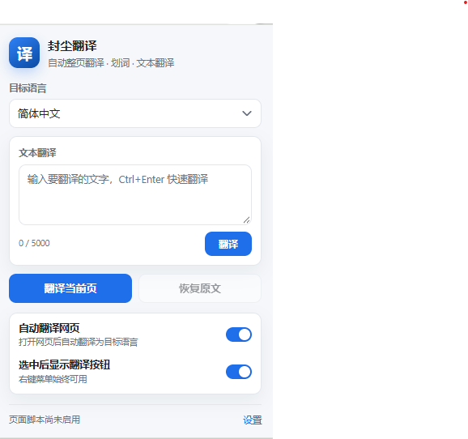

# 封尘翻译 · 整页与划词

一个免费的浏览器翻译扩展：打开网页自动翻译、整页翻译、划词翻译、右键翻译、手动输入翻译，并可一键恢复原文。

## 预览

## 功能

- **自动翻译网页**（默认开启）：打开网页后自动整页翻译为目标语言；页面语言与目标语言一致时自动跳过。
- **整页翻译**：点击弹窗中的「翻译当前页」，右下角显示进度，可随时取消。
- **一键恢复原文**：随时把页面还原成原文。
- **划词翻译**：选中文字后出现「译」按钮，点击查看原文与译文，可复制。
- **右键翻译**：选中文字后右键选择「翻译选中文本」。
- **手动输入翻译**：弹窗输入框粘贴文字，点「翻译」或 `Ctrl+Enter` 即时翻译，可一键复制。
- **多语言**：默认简体中文，可切换为繁体中文、英语、日语等 18 种语言。

## 安装

1. 打开 Chrome 的 `chrome://extensions`（或 Edge 的 `edge://extensions`）。
2. 打开右上角的「开发者模式」。
3. 点击「加载已解压的扩展程序」，选择本目录（包含 `manifest.json` 的目录）。
4. 可在工具栏扩展菜单中固定「封尘翻译」。
5. **安装或重新加载扩展后，请刷新已经打开的网页**，让翻译功能对新页面生效。

### 自动翻译网页（默认开启）

- 打开任意普通网页，加载完成后自动开始翻译，右下角显示进度，可点「取消」。
- 点「取消」或「恢复原文」后，本次浏览内不再自动翻译；重新打开页面后恢复正常。

### 整页翻译（手动）

1. 点击工具栏中的扩展图标，选择目标语言（默认「简体中文」）。
2. 点击「翻译当前页」，等待进度完成。
3. 点击「恢复原文」可还原页面。

> 已经翻译过的页面要换语言再翻，请先「恢复原文」。

### 划词翻译

- 用鼠标选中一段文字，选区附近会出现「译」按钮，点击查看译文。
- 支持复制译文、重试；按 `Esc` 或点击关闭按钮收起。
- 也可以选中文字后右键，选择「翻译选中文本」。

### 手动输入翻译

1. 点击工具栏图标打开弹窗，在「文本翻译」输入框输入文字（单次最多 5000 字）。
2. 点击「翻译」或按 `Ctrl+Enter`，译文显示在下方，可一键复制。

### 设置

点击弹窗中的「设置」，可调整：

- 目标语言；
- 是否自动翻译网页（默认开启）；
- 选中后是否显示翻译按钮（关闭后仍可用右键菜单翻译）；
- 清空翻译缓存。

## 注意事项

- 使用的是免费公共翻译接口，请求频率过高时可能被限流，稍后再试即可。
- 页面文本会发送给 Microsoft 的翻译服务，请不要翻译包含密码、密钥等敏感内容的页面。
- 不翻译 iframe 内的内容，以及输入框、代码块、图片文字等非普通文本。
- 页面翻译后再换目标语言，需要先「恢复原文」。

## 免责声明

本项目用于学习与个人使用，请遵守相关服务条款与法律法规，不要高频请求或用于侵犯他人权益的用途。
